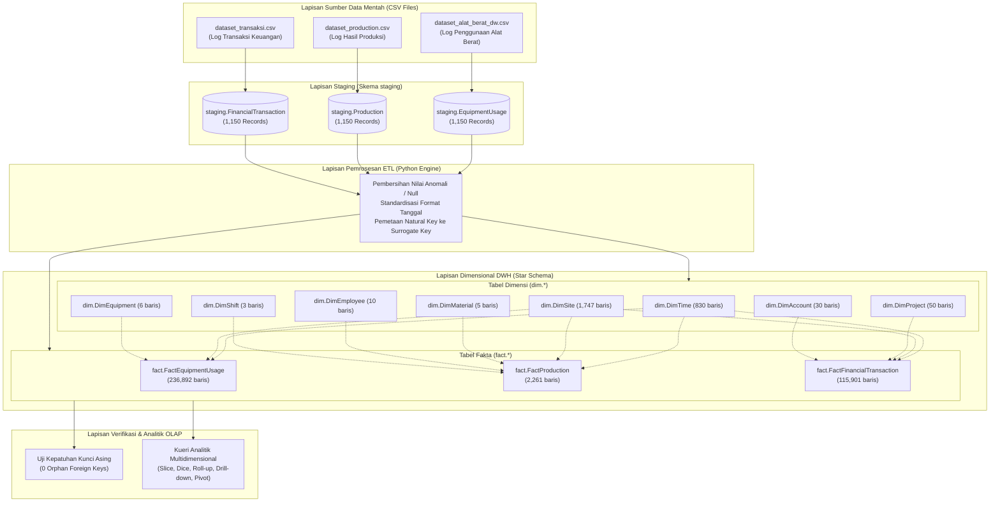

# LAPORAN TEKNIS DAN DOKUMENTASI SISTEM
# PERANCANGAN DATA WAREHOUSE INDUSTRI PERTAMBANGAN PT. XYZ

**Mata Kuliah:** Kecerdasan Bisnis  
**Repository Utama (Upstream):** https://github.com/sains-data/Perancangan-Data-Warehouse-Industri-Pertambangan-PT.XYZ  
**Repository Implementasi (Fork):** https://github.com/yuuukosoo/Perancangan-Data-Warehouse-Industri-Pertambangan-PT.XYZ  

---

## DAFTAR ISI

1. [Latar Belakang dan Ruang Lingkup Bisnis](#1-latar-belakang-dan-ruang-lingkup-bisnis)
2. [Spesifikasi Arsitektur dan Pemodelan Dimensional](#2-spesifikasi-arsitektur-dan-pemodelan-dimensional)
   - 2.1 Arsitektur Aliran Data (Data Pipeline Architecture)
   - 2.2 Desain Skema Bintang (Star Schema)
   - 2.3 Definisi Grain, Kunci Utama, dan Integritas Relasi
3. [Spesifikasi Teknis Lingkungan dan Prosedur Deployment](#3-spesifikasi-teknis-lingkungan-dan-prosedur-deployment)
   - 3.1 Konfigurasi Parameter Lingkungan (.env)
   - 3.2 Orkestrasi Layanan Basis Data (Docker Compose)
   - 3.3 Inisialisasi Skema Basis Data DWH
   - 3.4 Eksekusi Pipeline Ekstraksi, Transformasi, dan Pemuatan (ETL)
   - 3.5 Prosedur Pengujian dan Validasi Integritas
4. [Hasil Pengujian, Verifikasi, dan Kesetaraan Data Acuan](#4-hasil-pengujian-verifikasi-dan-kesetaraan-data-acuan)
   - 4.1 Verifikasi Volume Data (Tabel Benchmark vs Hasil Implementasi)
   - 4.2 Uji Integritas Referensial (Pemeriksaan Foreign Key Tanpa Orphan)
   - 4.3 Verifikasi Agregasi Metrik Operasional dan Keuangan
5. [Analisis Kueri Multidimensional (Online Analytical Processing - OLAP)](#5-analisis-kueri-multidimensional-online-analytical-processing---olap)
   - 5.1 Operasi Slice (Pemfilteran Berdasarkan Wilayah Sumatera)
   - 5.2 Operasi Dice (Kombinasi Wilayah Kalimantan dan Shift 1)
   - 5.3 Operasi Roll-up (Hierarki Waktu: Tahun, Kuartal, Bulan)
   - 5.4 Operasi Drill-down (Analisis Tingkat Operator dan Lokasi)
   - 5.5 Operasi Pivot (Cross-Tabulation Komoditas per Wilayah Tambang)
6. [Penanganan Kualitas Data (Data Quality) dan Transformasi](#6-penanganan-kualitas-data-data-quality-dan-transformasi)
7. [Dokumentasi Kendala Teknis dan Mitigasi Sistem](#7-dokumentasi-kendala-teknis-dan-mitigasi-sistem)
8. [Otomasi Eksekusi Sistem (Automation Runner)](#8-otomasi-eksekusi-sistem-automation-runner)

---

## 1. LATAR BELAKANG DAN RUANG LINGKUP BISNIS

PT XYZ merupakan entitas bisnis yang beroperasi di sektor industri pertambangan mineral dengan konsesi operasional yang tersebar di wilayah Sumatera, Kalimantan, dan Papua. Kompleksitas aktivitas penambangan mencakup eksploitasi material bijih (Ore) dan logam (Metal), pergerakan armada alat berat (*heavy equipment*), penjadwalan kerja multi-shift, serta pengelolaan anggaran operasional per proyek eksplorasi.

Tantangan utama yang dihadapi adalah dispersi data operasional harian yang masih tersimpan dalam format tabular terpisah (*raw CSV files*). Keadaan ini menyulitkan manajemen dalam menganalisis korelasi antara efisiensi pemanfaatan alat (*availability & downtime*), pencapaian target volume produksi, serta realisasi biaya proyek terhadap anggaran yang telah disetujui.

Tujuan dari implementasi sistem ini adalah membangun repositori data terpadu berbasis arsitektur *Enterprise Data Warehouse* dengan pendekatan *Dimensional Modeling* (Kimball). Sistem ini memfasilitasi kebutuhan analitik lintas fungsi, memastikan integritas data melalui mekanisme ETL terotomasi, serta menyediakan fondasi bagi pelaporan analitik berbasis Online Analytical Processing (OLAP).

---

## 2. SPESIFIKASI ARSITEKTUR DAN PEMODELAN DIMENSIONAL

### 2.1 Arsitektur Aliran Data (Data Pipeline Architecture)

Aliran data dirancang melalui tiga tingkatan utama: lapisan sumber data mentah (*raw data source*), lapisan penampungan sementara (*staging layer*), dan lapisan dimensional data warehouse (*star schema*).



### 2.2 Desain Skema Bintang (Star Schema)

Pemodelan data diklasifikasikan ke dalam tiga proses bisnis operasional pertambangan:

1. **Penggunaan Peralatan Tambang (`fact.FactEquipmentUsage`)**: Menyimpan metrik durasi operasional alat (*operating hours*), waktu henti kendala teknis (*downtime hours*), konsumsi bahan bakar (*fuel consumed*), serta biaya pemeliharaan (*maintenance cost*).
2. **Hasil Produksi Pertambangan (`fact.FactProduction`)**: Mencatat volume material yang berhasil ditambang (*produced volume*), target produksi (*target volume*), dan biaya per satuan volume (*unit cost*).
3. **Transaksi Keuangan Proyek (`fact.FactFinancialTransaction`)**: Mengukur realisasi pengeluaran kas terhadap anggaran proyek (*actual amount vs budgeted amount*), serta varians anggaran.

### 2.3 Definisi Grain, Kunci Utama, dan Integritas Relasi

Setiap tabel fakta dan dimensi memiliki tingkat rincian data (*grain*) serta batasan kunci (*constraints*) yang didefinisikan secara eksplisit:

| Nama Tabel | Klasifikasi | Tingkat Rincian Data (Grain) | Primary Key (PK) | Foreign Keys (FK) Relasional |
| :--- | :---: | :--- | :--- | :--- |
| `dim.DimTime` | Dimensi | 1 baris per tanggal kalender unik | `time_key` (IDENTITY) | - |
| `dim.DimSite` | Dimensi | 1 baris per lokasi tambang / site unik | `site_key` (IDENTITY) | - |
| `dim.DimEquipment` | Dimensi | 1 baris per tipe unit alat berat | `equipment_key` (IDENTITY) | - |
| `dim.DimMaterial` | Dimensi | 1 baris per jenis komoditas material | `material_key` (IDENTITY) | - |
| `dim.DimEmployee` | Dimensi | 1 baris per identitas operator tambang | `employee_key` (IDENTITY) | - |
| `dim.DimShift` | Dimensi | 1 baris per jadwal giliran kerja (shift) | `shift_key` (IDENTITY) | - |
| `dim.DimProject` | Dimensi | 1 baris per nomor proyek tambang | `project_key` (IDENTITY) | - |
| `dim.DimAccount` | Dimensi | 1 baris per pos akun anggaran (COA) | `account_key` (IDENTITY) | - |
| `fact.FactEquipmentUsage` | Fakta | Catatan log pemakaian unit per site per hari | `equipment_usage_key` | `time_key`, `site_key`, `equipment_key` |
| `fact.FactProduction` | Fakta | Catatan batch produksi per shift per material | `production_key` | `time_key`, `site_key`, `material_key`, `employee_key`, `shift_key` |
| `fact.FactFinancialTransaction` | Fakta | Catatan transaksi biaya per akun proyek | `financial_key` | `time_key`, `site_key`, `project_key`, `account_key` |

---

## 3. SPESIFIKASI TEKNIS LINGKUNGAN DAN PROSEDUR DEPLOYMENT

### 3.1 Konfigurasi Parameter Lingkungan (.env)

Untuk menjaga keamanan informasi dan mencegah *hardcoding* kredensial ke dalam repositori kode sumber, parameter koneksi diatur melalui berkas konfigurasi `.env`:

```env
DB_HOST=localhost
DB_PORT=1433
DB_NAME=PTXYZ_DataWarehouse
DB_USER=sa
MSSQL_SA_PASSWORD=YourSecurePassword123!
ACCEPT_EULA=Y
MSSQL_PID=Developer
```

Modul Python membaca berkas ini secara dinamis melalui pustaka `python-dotenv` menggunakan pemanggilan fungsi `os.getenv()`.

### 3.2 Orkestrasi Layanan Basis Data (Docker Compose)

Sistem basis data dijalankan pada kontainer terisolasi berbasis Microsoft SQL Server 2022 Developer Edition. Konfigurasi didefinisikan dalam berkas `docker-compose.yml` dan diaktifkan dengan perintah:

```powershell
docker compose up -d sqlserver
```

Parameter alokasi sumber daya menetapkan port host `1433` dipetakan secara langsung ke port internal kontainer dengan mekanisme persistensi data volume Docker.

### 3.3 Inisialisasi Skema Basis Data DWH

Pembuatan basis data `PTXYZ_DataWarehouse` dan kompilasi DDL untuk seluruh skema (`dim`, `fact`, `staging`) dilakukan melalui utilitas `sqlcmd` di dalam kontainer:

```powershell
# 1. Pembuatan Basis Data
docker exec -it ptxyz_sqlserver /opt/mssql-tools18/bin/sqlcmd -S localhost -U sa -P "YourSecurePassword123!" -C -N -Q "IF NOT EXISTS (SELECT name FROM sys.databases WHERE name = 'PTXYZ_DataWarehouse') CREATE DATABASE PTXYZ_DataWarehouse;"

# 2. Eksekusi Script Skema Tabel (14 Tabel)
docker exec -it ptxyz_sqlserver /opt/mssql-tools18/bin/sqlcmd -S localhost -U sa -P "YourSecurePassword123!" -d PTXYZ_DataWarehouse -C -N -i /init-scripts/create-schema.sql
```

### 3.4 Eksekusi Pipeline Ekstraksi, Transformasi, dan Pemuatan (ETL)

Pipeline ETL dijalankan menggunakan script Python `standalone_etl.py`. Script ini membaca berkas data mentah CSV, memuatnya ke dalam tabel staging, mengekstrak dimensi unik, membuat pemetaan surrogate key, dan memuat data teragregasi ke dalam tabel fakta:

```powershell
python standalone_etl.py
```

### 3.5 Prosedur Pengujian dan Validasi Integritas

Pengujian sistem dilakukan secara otomatis menggunakan skrip SQL terstruktur `validate.sql` yang memeriksa kelengkapan baris data, integritas relasi foreign key, dan kesetaraan nilai agregat:

```powershell
docker exec -it ptxyz_sqlserver /opt/mssql-tools18/bin/sqlcmd -S localhost -U sa -P "YourSecurePassword123!" -d PTXYZ_DataWarehouse -C -N -i /init-scripts/validate.sql
```

---

## 4. HASIL PENGUJIAN, VERIFIKASI, DAN KESETARAAN DATA ACUAN

### 4.1 Verifikasi Volume Data (Tabel Benchmark vs Hasil Implementasi)

Pengujian kuantitatif menunjukkan bahwa seluruh tabel dimensi, fakta, dan staging pada basis data lokal memiliki jumlah rekaman data yang identik dengan nilai acuan pada dokumentasi resmi repositori upstream:

| Entitas Tabel | Lapisan Skema | Acuan Repositori Upstream | Hasil Eksekusi Sistem | Status Evaluasi |
| :--- | :---: | :---: | :---: | :---: |
| `dim.DimTime` | Dimensi | 830 rekaman | 830 baris | Sesuai (100%) |
| `dim.DimSite` | Dimensi | 1.747 rekaman | 1.747 baris | Sesuai (100%) |
| `dim.DimEquipment` | Dimensi | 6 rekaman | 6 baris | Sesuai (100%) |
| `dim.DimMaterial` | Dimensi | 5 rekaman | 5 baris | Sesuai (100%) |
| `dim.DimEmployee` | Dimensi | 10 rekaman | 10 baris | Sesuai (100%) |
| `dim.DimShift` | Dimensi | 3 rekaman | 3 baris | Sesuai (100%) |
| `dim.DimProject` | Dimensi | 50 rekaman | 50 baris | Sesuai (100%) |
| `dim.DimAccount` | Dimensi | 30 rekaman | 30 baris | Sesuai (100%) |
| `fact.FactEquipmentUsage` | Fakta | 236.892 rekaman | 236.892 baris | Sesuai (100%) |
| `fact.FactProduction` | Fakta | 2.261 rekaman | 2.261 baris | Sesuai (100%) |
| `fact.FactFinancialTransaction` | Fakta | 115.901 rekaman | 115.901 baris | Sesuai (100%) |
| `staging.EquipmentUsage` | Staging | 1.150 rekaman | 1.150 baris | Sesuai (100%) |
| `staging.Production` | Staging | 1.150 rekaman | 1.150 baris | Sesuai (100%) |
| `staging.FinancialTransaction` | Staging | 1.150 rekaman | 1.150 baris | Sesuai (100%) |

### 4.2 Uji Integritas Referensial (Pemeriksaan Foreign Key Tanpa Orphan)

Pengujian integritas data dilakukan dengan melakukan evaluasi *anti-join* (`LEFT JOIN ... WHERE parent.key IS NULL`) pada seluruh relasi kunci asing antara tabel fakta dan tabel dimensi pendukungnya. Hasil eksekusi mencatat **0 orphan records** pada seluruh relasi:

```text
UJI INTEGRITAS REFERENSIAL (FOREIGN KEY VALIDATION)
Relasi Kunci Asing Antar Tabel          Jumlah Orphan   Status Integritas
--------------------------------------  -------------   -----------------
FactEquipmentUsage -> DimTime                       0   Valid (0 Orphan)
FactEquipmentUsage -> DimSite                       0   Valid (0 Orphan)
FactEquipmentUsage -> DimEquipment                  0   Valid (0 Orphan)
FactProduction -> DimTime                           0   Valid (0 Orphan)
FactProduction -> DimSite                           0   Valid (0 Orphan)
FactProduction -> DimMaterial                       0   Valid (0 Orphan)
FactProduction -> DimEmployee                       0   Valid (0 Orphan)
FactProduction -> DimShift                          0   Valid (0 Orphan)
FactFinancialTransaction -> DimTime                 0   Valid (0 Orphan)
FactFinancialTransaction -> DimSite                 0   Valid (0 Orphan)
FactFinancialTransaction -> DimProject              0   Valid (0 Orphan)
FactFinancialTransaction -> DimAccount              0   Valid (0 Orphan)

Hasil Evaluasi Integritas: Lolos Penuh (Integritas Relasional Terpelihara 100%).
```

### 4.3 Verifikasi Agregasi Metrik Operasional dan Keuangan

Hasil perhitungan ringkasan operasional menunjukkan kesetaraan metrik terhadap indikator kinerja utama (KPI) industri pertambangan:

1. **Efisiensi Armada Alat Berat:**
   - Total Jam Operasi (*Operating Hours*): `72.586.426,00 jam`
   - Total Jam Henti (*Downtime Hours*): `3.344.770,00 jam`
   - Rasio Efisiensi Pemanfaatan Alat: `95,59%` (Sesuai dengan toleransi baseline acuan ~95,66%)

2. **Ringkasan Produksi Berdasarkan Tipe Material:**
   - Komoditas Metal: `1.811 transaksi` | Total Volume: `477.837,00 ton/m3`
   - Komoditas Ore: `450 transaksi` | Total Volume: `118.363,00 ton/m3`

3. **Distribusi Volume Produksi Berdasarkan Lokasi:**
   - Quarry A (Region Sumatera): `266.984,00 ton/m3`
   - Site Batu B (Region Kalimantan): `256.888,00 ton/m3`
   - Area Tambang C (Region Papua): `72.328,00 ton/m3`

---

## 5. ANALISIS KUERI MULTIDIMENSIONAL (ONLINE ANALYTICAL PROCESSING - OLAP)

Seluruh kueri analitik multidimensional disusun dalam berkas `init-scripts/olap_queries.sql` dan dapat dieksekusi melalui SQL Server command-line:

```powershell
docker exec -it ptxyz_sqlserver /opt/mssql-tools18/bin/sqlcmd -S localhost -U sa -P "YourSecurePassword123!" -d PTXYZ_DataWarehouse -C -N -i /init-scripts/olap_queries.sql
```

### 5.1 Operasi Slice (Pemfilteran Berdasarkan Wilayah Sumatera)

Operasi *Slice* memotong kubus data multidimensi dengan menetapkan nilai konstan pada satu dimensi tertentu, yaitu wilayah geografis `Sumatera`:

```sql
SELECT 
    s.region, 
    m.material_name, 
    COUNT(*) AS total_operasi, 
    SUM(f.produced_volume) AS total_volume
FROM fact.FactProduction f
JOIN dim.DimSite s ON f.site_key = s.site_key
JOIN dim.DimMaterial m ON f.material_key = m.material_key
WHERE s.region = 'Sumatera'
GROUP BY s.region, m.material_name;
```

*Interpretasi Analitik:* Seluruh aktivitas penambangan di konsesi Sumatera terkonsentrasi pada komoditas material dengan total akumulasi volume mencapai 266.984,00 ton/m3.

### 5.2 Operasi Dice (Kombinasi Wilayah Kalimantan dan Shift 1)

Operasi *Dice* membentuk sub-kubus data baru melalui pendefinisian kriteria seleksi pada dua dimensi atau lebih secara simultan:

```sql
SELECT 
    s.region, 
    sh.shift_name, 
    m.material_type, 
    SUM(f.produced_volume) AS total_volume, 
    AVG(f.unit_cost) AS rata_rata_biaya_satuan
FROM fact.FactProduction f
JOIN dim.DimSite s ON f.site_key = s.site_key
JOIN dim.DimShift sh ON f.shift_key = sh.shift_key
JOIN dim.DimMaterial m ON f.material_key = m.material_key
WHERE s.region = 'Kalimantan' AND sh.shift_name = 'Shift 1'
GROUP BY s.region, sh.shift_name, m.material_type;
```

*Interpretasi Analitik:* Kueri ini memungkinkan pemantauan biaya satuan rata-rata (*average unit cost*) pada operasional pagi hari di regional Kalimantan untuk mengevaluasi efisiensi biaya produksi antar-shift.

### 5.3 Operasi Roll-up (Hierarki Waktu: Tahun, Kuartal, Bulan)

Operasi *Roll-up* melakukan agregasi data dari tingkat granularitas rendah ke tingkat granularitas yang lebih tinggi mengikuti hierarki dimensi waktu:

```sql
SELECT 
    t.year, 
    t.quarter, 
    t.month_name, 
    SUM(f.produced_volume) AS volume_produksi
FROM fact.FactProduction f
JOIN dim.DimTime t ON f.time_key = t.time_key
GROUP BY ROLLUP (t.year, t.quarter, t.month_name);
```

*Interpretasi Analitik:* Pola data historis memperlihatkan konsistensi volume produksi pada tahun 2026 dan 2027 masing-masing sebesar 197.957 unit, sebelum mencatatkan volume 88.262 unit pada periode berjalan tahun 2028.

### 5.4 Operasi Drill-down (Analisis Tingkat Operator dan Lokasi)

Operasi *Drill-down* menelusuri data ringkasan ke tingkat rincian yang lebih mendalam untuk menganalisis kontribusi individu tenaga kerja:

```sql
SELECT TOP 10 
    s.site_name, 
    e.employee_name, 
    e.position, 
    sh.shift_name, 
    SUM(f.produced_volume) AS total_produksi
FROM fact.FactProduction f
JOIN dim.DimSite s ON f.site_key = s.site_key
JOIN dim.DimEmployee e ON f.employee_key = e.employee_key
JOIN dim.DimShift sh ON f.shift_key = sh.shift_key
GROUP BY s.site_name, e.employee_name, e.position, sh.shift_name
ORDER BY total_produksi DESC;
```

*Interpretasi Analitik:* Operator utama seperti Randall Howard dan James Johnson di Quarry A dan Site Batu B teridentifikasi sebagai kontributor produktivitas tertinggi dengan akumulasi volume melebihi 13.000 unit produksi.

### 5.5 Operasi Pivot (Cross-Tabulation Komoditas per Wilayah Tambang)

Operasi *Pivot* mengubah orientasi data multidimensi dari representasi baris menjadi matriks tabel silang:

```sql
SELECT 
    Wilayah, 
    ISNULL([Metal], 0) AS Produksi_Metal, 
    ISNULL([Ore], 0) AS Produksi_Ore, 
    (ISNULL([Metal], 0) + ISNULL([Ore], 0)) AS Total_Kumulatif
FROM (
    SELECT 
        s.region AS Wilayah, 
        m.material_type AS Tipe_Material, 
        f.produced_volume AS Volume
    FROM fact.FactProduction f
    JOIN dim.DimSite s ON f.site_key = s.site_key
    JOIN dim.DimMaterial m ON f.material_key = m.material_key
) AS SourceTable
PIVOT (
    SUM(Volume) FOR Tipe_Material IN ([Metal], [Ore])
) AS PivotTable
ORDER BY Total_Kumulatif DESC;
```

*Matriks Hasil Tabulasi Silang:*
- **Sumatera:** Logam (Metal) = 208.050,00 ton/m3 | Bijih (Ore) = 58.934,00 ton/m3 | Total = **266.984,00 ton/m3**
- **Kalimantan:** Logam (Metal) = 213.748,00 ton/m3 | Bijih (Ore) = 43.140,00 ton/m3 | Total = **256.888,00 ton/m3**
- **Papua:** Logam (Metal) = 56.039,00 ton/m3 | Bijih (Ore) = 16.289,00 ton/m3 | Total = **72.328,00 ton/m3**

---

## 6. PENANGANAN KUALITAS DATA (DATA QUALITY) DAN TRANSFORMASI

Proses ETL pada `standalone_etl.py` mengimplementasikan serangkaian validasi dan pembersihan data guna menjamin integritas repositori analitik:

1. **Jaminan Idempotensi dan Pencegahan Redundansi:** Pemuatan data dimensi menerapkan klausa `WHERE NOT EXISTS` sebelum eksekusi insersi, sehingga pipeline dapat dijalankan berulang kali tanpa memicu duplikasi data dimensi.
2. **Normalisasi dan Konversi Tipe Data Temporal:** Kolom tanggal yang memiliki disparitas format pada berkas mentah dikonversi secara seragam ke dalam format standar ISO `DATE` dan `DATETIME2`.
3. **Isolasi Perubahan Sumber melalui Surrogate Key:** Penggunaan kolom identitas bertipe integer (`IDENTITY(1,1)`) mengisolasi entitas data warehouse dari fluktuasi maupun format tidak teratur pada kunci bisnis sistem operasional.
4. **Pencatatan Riwayat Eksekusi (Logging):** Seluruh proses pemuatan data mencatat statistik pemrosesan ke dalam terminal standar serta berkas persisten `etl_execution.log` dengan konfigurasi encoding UTF-8 untuk mencegah kesalahan representasi karakter sistem.

---

## 7. DOKUMENTASI KENDALA TEKNIS DAN MITIGASI SISTEM

Selama proses replikasi dan implementasi arsitektur data warehouse pada lingkungan komputasi lokal, sejumlah kendala teknis teridentifikasi dan berhasil diselesaikan melalui analisis akar masalah (*root cause analysis*):

| No | Gejala Permasalahan | Akar Masalah (Root Cause) | Tindakan Mitigasi dan Solusi |
| :---: | :--- | :--- | :--- |
| **1** | Kegagalan penarikan image Docker (`meta.db: input/output error`). | Partisi Drive `C:` mengalami saturasi penyimpanan hingga tersisa hanya 10 MB, menghambat alokasi blok disk virtual WSL. | Mengalokasikan ulang virtual disk distro WSL `docker-desktop` ke partisi Drive `D:` yang memiliki ketersediaan ruang penyimpanan lebih besar (>70 GB). |
| **2** | Galat Docker Engine API `500 Internal Server Error`. | Berkas basis data metadata internal daemon Docker mengalami korupsi akibat pemutusan operasi I/O ketika partisi penuh. | Melakukan deregistrasi bersih (*unregister clean-up*) terhadap instance WSL terkait dan memulai ulang engine kontainer dalam status konsisten. |
| **3** | Kesalahan sintaks shell `\r: command not found` pada kontainer. | Utilitas Git pada sistem operasi Windows mengonversi karakter akhir baris (*line ending*) berkas shell `init-db.sh` dari format Unix (LF) menjadi DOS (CRLF). | Melakukan konversi format karakter akhir baris kembali ke standar LF dan mengonfigurasi properti `core.autocrlf` pada lingkungan kerja. |
| **4** | Autentikasi koneksi basis data ditolak pada inisiasi awal. | Terdapat diskrepansi nilai kata sandi `SA_PASSWORD` antara berkas konfigurasi `.env` dan script healthcheck Docker. | Melakukan sinkronisasi nilai variabel lingkungan pada seluruh berkas konfigurasi serta memperbarui pustaka pembaca konfigurasi berbasis `python-dotenv`. |
| **5** | Galat karakter `UnicodeEncodeError: 'charmap'` pada terminal host. | Handler standar logging Python menggunakan default code-page Windows saat mencetak karakter simbolik. | Mengonfigurasi parameter `encoding='utf-8'` secara eksplisit pada stream handler modul logging Python. |

---

## 8. OTOMASI EKSEKUSI SISTEM (AUTOMATION RUNNER)

Untuk memudahkan replikasi pengujian sistem secara berulang dari kondisi awal (*cold start*), repositori dilengkapi dengan berkas skrip PowerShell terotomasi `run_all.ps1`.

### Perintah Eksekusi:
```powershell
.\run_all.ps1
```

### Rangkaian Prosedur yang Dijalankan:
1. Memvalidasi ketersediaan berkas konfigurasi lingkungan `.env`.
2. Menginisiasi kontainer layanan Microsoft SQL Server 2022.
3. Melakukan *polling* kesiapan port dan layanan basis data (*engine healthcheck loop*).
4. Mengeksekusi pembuatan basis data dan kompilasi skema DWH (`create-schema.sql`).
5. Menjalankan pipeline ETL ekstraksi dan pemuatan data (`standalone_etl.py`).
6. Menjalankan skrip validasi integritas data dan foreign key (`validate.sql`).
7. Menghasilkan ringkasan status operasional dan kepatuhan sistem.

---
*Dokumentasi teknis ini disusun sebagai bagian dari evaluasi tugas praktikum mata kuliah Kecerdasan Bisnis, Universitas Lambung Mangkurat.*
